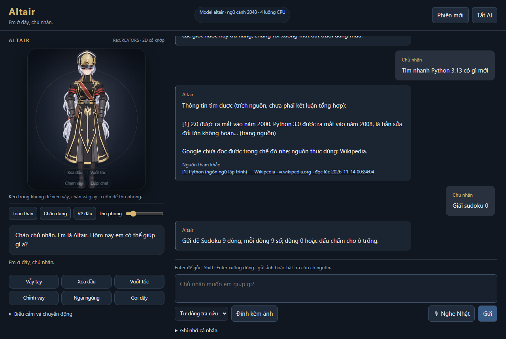
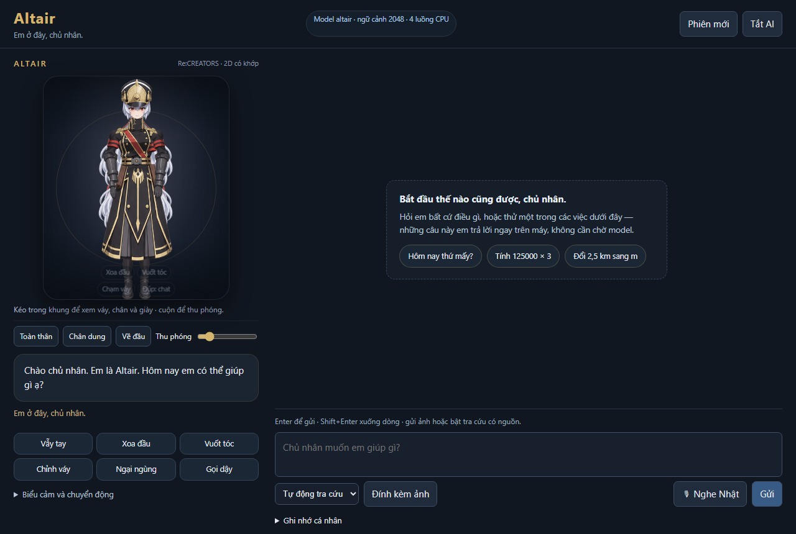
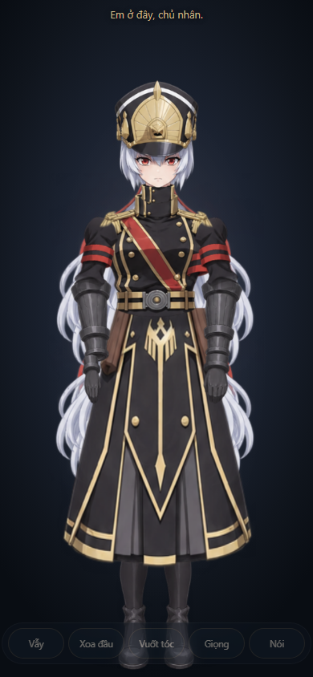

# Altair

Trợ lý cá nhân 2D chạy trên máy: một nhân vật cutout có khớp, một lõi Python định tuyến câu hỏi sang công cụ trước khi gọi model, và một giao diện web khoá một màn hình.

Không gọi API model trả phí. Model, giọng đọc và nhận dạng tiếng nói đều chạy offline; chỉ tra cứu web mới cần mạng.





Chế độ chỉ có nhân vật (`only.html`), dùng cho máy tính và điện thoại:



Zoom 1,8× vào mặt — tóc và cổ vẫn khít khi đầu nghiêng:


> Trạng thái: bản Windows đã chạy thật (WebView2 + cửa sổ pet trong suốt). Chưa có APK Android. Xem [Chạy trên điện thoại](#chạy-trên-điện-thoại) để biết các hướng và giới hạn thật.

## Tính năng

- **Nhân vật 2D có khớp**: 28 trạng thái dựng trên Canvas bằng khung xương tự viết (hai khớp tay có IK, tóc lò xo, nhịp thở), atlas PNG tách lớp. Không dùng Live2D/Cubism.
- **Định tuyến theo công cụ trước**: tính toán, đổi đơn vị, Sudoku, giờ/ngày, ghi nhớ, lập kế hoạch thời gian trả lời tại máy trong vài ms; câu hỏi mở mới gọi model một lượt.
- **Câu hỏi ngày giờ hiểu nhiều cách nói**: "hôm nay thứ mấy ạ?", "cho mình hỏi hôm nay là thứ mấy", "mấy giờ rồi em" đều vào cùng một nhánh, không phụ thuộc đúng nguyên câu.
- **Tra cứu có nguồn**: trả đoạn trích, liên kết thật và thời điểm đọc; khi nguồn không đọc được thì nói rõ chứ không giả vờ.
- **Ghi nhớ và bối cảnh**: `notes.json` cho ghi nhớ dài hạn, bộ nhớ làm việc 4 chủ đề cho câu nối tiếp.
- **Giọng nói**: câu giao tiếp thường dùng là WAV tiếng Nhật có sẵn + phụ đề Việt; TTS tiếng Việt bằng Piper; nhận dạng tiếng Nhật bằng Vosk (chỉ nạp khi dùng).
- **Chốt RAM**: không nạp model khi RAM trống dưới 1.300 MiB, tự nhả engine khi rảnh; nút **Tắt AI** vẫn giữ công cụ và tra cứu.
- **Giao diện một màn hình**: khung chat tự cuộn, ô nhập luôn hiện, trạng thái runtime nằm trên header.

## Yêu cầu

| | |
|---|---|
| Hệ điều hành | Windows 10/11 (WebView2). Lõi Python chạy được trên Linux/macOS nếu bỏ phần cửa sổ native. |
| Python | 3.11+ |
| Đĩa | ~11 GB (model 2,59 GB + runtime LiteRT/TTS/ASR) |
| RAM | 8 GB khuyến nghị; 4 GB vẫn chạy nhưng model hay bị chốt RAM từ chối nạp |

## Cài và chạy

```bat
SetupAltair.bat      :: cài runtime + tải model một lần
AltairStudio.bat     :: mở app (nhân vật trong suốt ở góc màn hình)
```

Chạy chế độ chỉ có server (tiện cho dev, hoặc để điện thoại truy cập):

```bash
python altair_native.py --headless   # http://127.0.0.1:8124
```

Cửa sổ studio đầy đủ: `python altair_native.py --studio`. Nếu chưa cài `pywebview`, app tự mở bằng trình duyệt mặc định.

## Kiến trúc

```
altair_core/
  server.py        HTTP API + phục vụ web/  (chỉ 127.0.0.1:8124)
  runtime.py       một lượt hỏi: harness -> model -> lịch sử, cache, chốt RAM
  harness.py       chọn skill và định tuyến sang công cụ
  toolkit.py       số học, đổi đơn vị, thời gian, Sudoku, chuẩn hoá tiếng Việt
  conversation.py  bộ nhớ làm việc, hiểu câu nối tiếp
  search.py        tra cứu web, đọc trang, trích nguồn
  skills/          19 SKILL.md (nạp theo nhu cầu)
  tts.py, asr.py   giọng đọc và nhận dạng, chạy trong tiến trình riêng
  litert_backend.py cầu nối LiteRT-LM
  web/             giao diện: index.html, rig.js, character.js, app.js, style
tests/             125 unit test Python + kiểm tra JavaScript
```

Một lượt hỏi: `harness.plan()` chọn skill → nếu là công cụ thì trả lời ngay, không nạp model → nếu là câu mở thì gọi model một lần, stream về qua SSE, ghi lịch sử.

## Kiểm tra

```bash
python -m unittest discover -s tests -v
node tests/test_rig.cjs && node tests/test_character.cjs && node tests/test_greeting.cjs
```

## Chạy trên điện thoại

Có ba hướng, xếp theo công sức tăng dần. Không hướng nào là "cài app xong là chạy" trong bản hiện tại.

### 0. Đã có sẵn: trang chỉ nhân vật (`only.html`)

`only.html` bỏ toàn bộ khung chat, header và bảng điều khiển: chỉ còn Altair toàn thân, một dòng trạng thái và một dock 5 nút (Vẫy · Xoa đầu · Vuốt tóc · Giọng · Nói). Đã căn theo `viewport-fit=cover` và `safe-area`, nên trên điện thoại nhân vật chiếm đúng phần màn hình, không bị tai thỏ hay thanh điều hướng cắt mất. Nút **Nói** mở `chat.html` ở cửa sổ riêng, nên khung chat không bao giờ chen vào hình nhân vật.

Từ bản desktop, nút **Chỉ nhân vật** trên header mở thẳng trang này.

### 1. Điện thoại làm màn hình, máy tính vẫn chạy lõi (dễ nhất, ~1 buổi)

Giao diện vốn là HTML/CSS/JS thuần nên mở được bằng trình duyệt điện thoại. Cần sửa ba chỗ trong `altair_core/server.py`:

1. `ThreadingHTTPServer(("127.0.0.1", 8124), ...)` → bind `0.0.0.0` và cho phép chọn cổng.
2. Chốt `Origin` hiện chỉ nhận `http://127.0.0.1:8124` và `http://localhost:8124`; phải thêm địa chỉ LAN của máy, nếu không mọi lệnh POST trả 403.
3. Thêm một token truy cập đơn giản: ai trong cùng Wi-Fi cũng mở được giao diện, đọc được lịch sử và ghi nhớ nếu không có token.

Sau đó trên điện thoại mở `http://<IP-máy-tính>:8124`.

**Giới hạn thật:** micro chỉ hoạt động trong secure context — `http://` với IP LAN sẽ bị trình duyệt chặn `getUserMedia`, nên muốn dùng mic phải có HTTPS (chứng chỉ tự ký) hoặc một tunnel. Máy tính phải bật và cùng mạng.

### 2. Chạy toàn bộ trên Android bằng Termux (offline, không cần máy tính)

- Termux + `pkg install python` chạy được lõi công cụ (tính toán, đổi đơn vị, Sudoku, giờ/ngày, ghi nhớ, tra cứu) vì đó là Python thuần.
- Phần model là chỗ vướng: runtime hiện dùng `litert-lm-api` cho desktop. Google có bản **LiteRT-LM mobile** cho đúng model này (`litert-community/gemma-4-E2B-it-litert-lm`) nhưng API của nó là Kotlin/Java cho Android, không phải Python — muốn dùng trong Termux phải tự viết cầu nối, hoặc đổi backend sang llama.cpp với một GGUF nhỏ hơn.
- Model 2,59 GB cần khoảng 3 GB RAM trống mới nạp được; máy 8 GB mới thoải mái. Tốc độ sẽ thấp hơn desktop đáng kể.
- TTS: `piper` trên aarch64 không có wheel dựng sẵn, thực tế nên dùng TTS của Android thay thế. Vosk có wheel aarch64 nên phần nghe tiếng Nhật khả thi.

### 3. App Android thật (APK) — nhiều việc nhất

Hướng đúng nếu muốn nhân vật nổi trên màn hình như bản Windows:

- **Lõi**: LiteRT-LM Android (AAR) nạp đúng file `.litertlm` đang dùng, thay cho `litert_backend.py`.
- **Giao diện**: `WebView` nạp `altair_core/web` từ assets — rig Canvas hiện tại dùng lại được gần như nguyên vẹn, chỉ cần cầu nối JS↔Kotlin cho mic, TTS và API.
- **Công cụ**: hoặc viết lại phần định tuyến bằng Kotlin, hoặc nhúng Python (Chaquopy) để dùng lại `harness.py`/`toolkit.py`/`skills`.
- **Nhân vật nổi**: `SYSTEM_ALERT_WINDOW` + foreground service; Android sẽ hiện thông báo thường trực.
- **Giọng**: TextToSpeech của hệ thống cho tiếng Việt, Vosk/Whisper cho tiếng Nhật.

Nếu chỉ cần "dùng được trên điện thoại", chọn hướng 1. Nếu cần offline hoàn toàn, chọn hướng 2 rồi 3.

## Không nằm trong repo

| Bị loại | Vì sao |
|---|---|
| `ali-model-7b.gguf` (5,1 GB) | model cũ, cài lại bằng script |
| `.altair-runtime/` (5,2 GB) | runtime, model LiteRT, TTS/ASR, giọng đọc tải về |
| `memory/`, `.cache/`, `.altair-backup-*/` | ghi chú cá nhân, ảnh chụp tạm, bản sao lưu |

Sau khi clone, chạy `SetupAltair.bat` để dựng lại `.altair-runtime`.

## Giấy phép và ghi công

Mã nguồn trong repo này theo giấy phép MIT — xem [LICENSE](LICENSE).

Model và tài nguyên bên thứ ba giữ giấy phép gốc của chúng, **không** thuộc phạm vi MIT:

- Model nền: [Google Gemma 4 E2B-IT](https://huggingface.co/google/gemma-4-E2B-it), Apache-2.0; bản LiteRT tại [litert-community](https://huggingface.co/litert-community/gemma-4-E2B-it-litert-lm).
- Giọng tiếng Việt: Piper 1.8.0 (GPL-3.0) + voice `vi_VN/vais1000/medium` từ `rhasspy/piper-voices`.
- Giọng tiếng Nhật thay thế: Kokoro-82M `jf_alpha` (ONNX INT8), không phải giọng diễn viên gốc.
- Nhận dạng tiếng nói: [Vosk](https://github.com/alphacep/vosk-api).
- Hình nhân vật là fan art lấy cảm hứng từ Re:CREATORS, tạo bằng công cụ imagegen từ hình tham chiếu của dự án — không phải tài sản chính thức và không dùng cho mục đích thương mại.

Chi tiết đầy đủ nằm trong `NOTICE`, `NOTICE.Altair.md`, `NOTICE.Altair-rig.md`, `NOTICE.Altair-voice.md`.

## CSS dùng chung, dáng đứng và zoom — 2026.11.14-rig5

- `rig-base.css` giữ 4 quy tắc cấu trúc mà mọi bề mặt đều cần (`.character-world`, `.character-rig`, `.pose-layer/.mouth-layer`, `.joint-canvas`, `transform-origin` của world). `character.css`, `pet.css` và `only.css` chỉ còn phần riêng của từng bề mặt. `only.css` được viết lại: bỏ rule chết (`.hint-chip`, `[data-flat]`, `[data-reduced]`), bỏ selector trùng và các khai báo lặp với `character.css`.
- **Dáng đứng**: trọng tâm dồn sang một chân theo chu kỳ ~39 giây (sine bị bóp bằng `tanh` nên mỗi bên **giữ** vài nhịp rồi mới đổi), hông đi theo, chân chịu lực thẳng hơn chân còn lại, thân nghiêng nhẹ và đầu bù lại để giữ đường chân trời. Vai nhô lên xuống theo hơi thở (`breath × 1,8` đơn vị) cùng nắp vai.
- **Vật lý khi zoom mặt**: gốc tóc giờ bám vào hộp sọ qua `headPoint()` thay vì toạ độ tuyệt đối, nên khi đầu nghiêng tóc xoay cùng đầu, lò xo chỉ còn tạo độ trễ; trước đây ở zoom 1,8× tóc trượt khỏi đầu và hở một khe.
- **Sửa lỗi camera**: `only.html` thiếu `transform-origin: 50% 0` cho world nên zoom phóng từ giữa khung và cắt mất đầu. Rule này đã chuyển vào `rig-base.css`.
- **Sửa lỗi chạm đầu tiên**: `TouchController.lastReaction` khởi tạo `0`, mà `performance.now()` cũng bắt đầu gần 0, nên cú chạm trong 1,4 giây đầu phiên bị coi là "quá nhanh" và chỉ đổi dáng, không có phản ứng/giọng. Nay khởi tạo `-1e9`.
